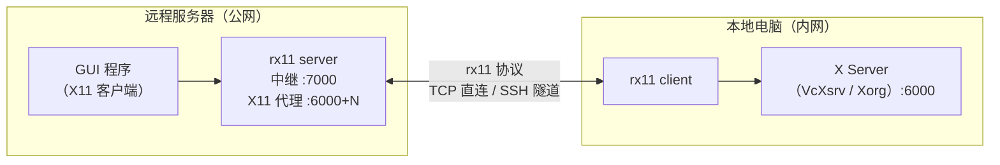
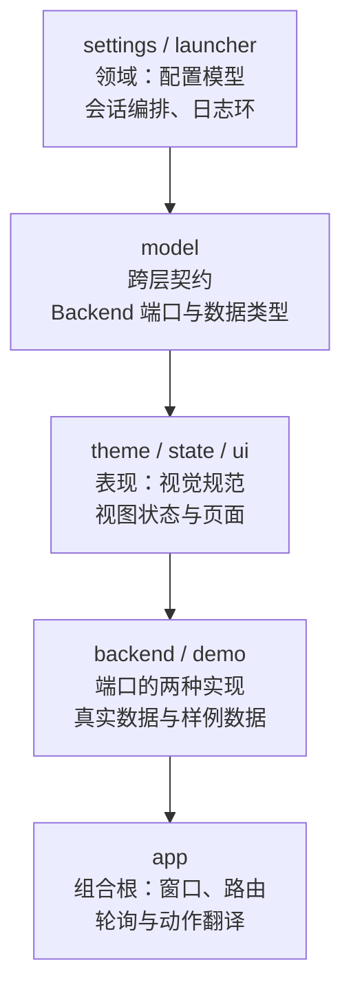
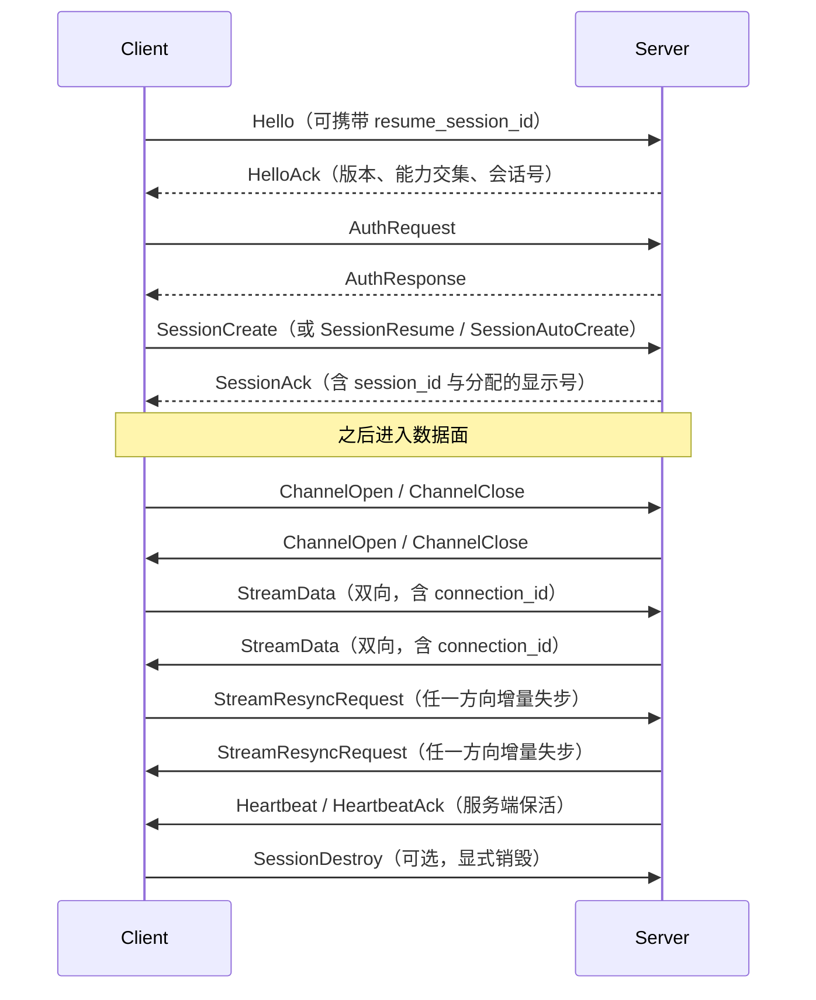

# rx11 — 远程 X11 转发工具

[English](README.en.md)

通过自研协议中继 X11 连接，让你在本地电脑（内网）查看远程服务器（公网）上运行的 GUI 程序画面。

支持 **TCP 直连** 和 **SSH 隧道** 两种模式。

## 工作原理



**核心流程：**

1. 远程服务器启动 `rx11 server`，监听中继端口 (7000) 并代理 X11 端口 (6000+N)
2. 本地电脑启动 `rx11 client`，通过 TCP 或 SSH 隧道连接到远程中继
3. 远程服务器设置 `DISPLAY=:0`，运行 GUI 程序
4. GUI 程序的 X11 绘图指令经中继转发到本地 X Server，画面呈现在本地屏幕上

## 特性

- **多连接多路复用** — 单个中继会话上承载多个 X11 应用连接，通过 `connection_id` 区分
- **自动重连 + 会话恢复** — 网络中断后客户端自动指数退避重连（最多 10 次），服务端保留会话 60 秒宽限期，重连后已建立的 X11 应用连接不受影响
- **心跳保活** — 服务端每 30 秒发送心跳，客户端即时应答；服务端 90 秒无响应断开，客户端 100 秒无数据超时重连，避免半开连接
- **X Server 自动检测** — 连接前自动探测本地 X Server 是否可用，并给出平台特定提示
- **xauth 集成** — 服务端自动管理 `xauth` 条目（MIT-MAGIC-COOKIE-1），增强安全性
- **优雅关闭** — Ctrl+C 时发送 `SessionDestroy` 帧清理远程会话；`rx11 run` 自动将信号转发给子进程
- **连接统计** — 每 30 秒输出收发字节数、帧数、活跃连接数等统计信息
- **配置文件** — 支持 TOML 配置文件，CLI 参数 > 环境变量 > 配置文件 > 默认值
- **多 Display** — 通过 `-d` 参数同时运行多个独立的 GUI 会话
- **Display 自动分配** — 默认由服务端自动分配可用的 Display 编号，需要时可手动指定
- **数据压缩** — 默认 zstd **跨帧流式**（`zstd_stream`：一条持续压缩流按帧 flush，后续帧复用历史；窗口重绘类流量在慢速链路上字节量大幅下降），可协商回退 zstd/lz4/zlib 单帧模式；超 256 字节自动压缩
- **公网排队治理** — 发往中继的出站队列按**字节预算**封顶（默认 1 MB），慢链路不会积累分钟级积压；配合可选 `SO_SNDBUF` 上限，交互延迟预算 ≈ 队列+内核缓冲 ÷ 链路速率
- **图像流量重编码（默认开启）** — `x11_recode` 能力：识别 X 协议里的大块 `PutImage` 请求（ZPixmap 24/32 位），在线路上换成 JPEG（有损，省 10~50 倍）或无损 PNG，收端展开后以原始请求字节写回本地 X server；非图像请求逐字节透传。默认开启（PNG 无损档）：任一端 `[runtime] image_recode = false` 即整链逐字节透传；JPEG 有损档只有显式 `image_recode_codec = "jpeg"` 才会启用。边界：GL 渲染的视频、Xv 扩展路径不在识别范围——那是帧缓冲模式（Xpra/x2go 的领域），不是透明转发器该假装的
- **桌面音频转发（默认开启）** — `audio` 通道：服务端采集默认输出 sink 的 monitor，Opus（**纯 Rust** 移植，48 kHz 立体声，构建零系统库要求）编码后走**实时优先道**下推，收端解码交给 `paplay` 播放。全服务**一份采集一份编码**扇出给所有客户端：多客户端不重复起 parec、不重复编码；迟到者从下一帧接上；最后一个监听者离开后录音器自动停。64 kbit/s 约占 3 Mbps 链路 2%；优先道不受出站字节预算排队，图像洪峰下音频延迟以单个写块为界。默认开启，任一端 `audio_forward = false` 即关；端点没有采集/播放栈（parec/paplay）时自动静默降级不影响会话。边界：只放声音，不做麦克风反向输入，不做唇音同步
- **按应用转发音频（默认开启）** — `audio_per_app` 能力：服务端把每一路声音归属到产生它的那个应用（按进程归属判定），为该应用的每一条 X11 连接各开一条 `audio` 通道，通道上带产生这段声音的 X11 连接标签（同一个应用的多个连接听到的是同一段声音，编码只做一次）；客户端据此**只播放当前渲染的那个应用的声音**，而不是把整个远端桌面的声音一股脑放出来。任一端 `audio_per_app = false` 即退回整桌面混音；主机本身不支持按应用采集时也自动退回整桌面混音（声音照旧，混音而非分流）
- **逐通道流控（默认开启）** — `flow_control` 能力：接收端「已收下但没消费完」的积压超过高水位（默认 2 MB）就对该通道（`connection_id` 粒度，上下行各自计量）宣告 Pause，发端大块泵**停止从源头 socket 读取**——积压退到内核缓冲和应用自己的 `write()` 里，一个字节都不丢；回落到低于低水位（默认 256 KB）宣告 Resume。流控帧走**实时优先道**并周期性再宣告：信号自己不排在洪峰后面，优先道满丢弃也可再宣告找回；控制帧（心跳/会话）与音频道永不被它门控。同向通道双向同时堵时，下行让位上行——双向互门会冻住 X11 会话，推迟新请求不会。任一端 `[runtime] flow_control = false` 即整链退回纯传输背压（字节预算队列）
- **增量传输** — 重复度高的 X11 帧只传差异块（可再叠加压缩），画面下行与请求上行两个方向各自差分（`incremental_uplink` 单独控制上行）；**内容完全未变的帧退化为零块引用帧——整帧只有 29 字节（11 字节帧头 + 18 字节差分头），载荷一个字节不再重复上线**（帧本身照发——X11 字节流是定位式的，序号必须前进）；接收端 diff 失步时自动请求回退全帧，自愈不丢流
- **能力协商** — 增量/上行增量/重同步/流控/重编码/音频/按应用音频等特性经 Hello/HelloAck 交集协商，未协商即不发送；新特性可按名字灰度上线
- **通道类型可扩展** — 数据面帧族与载荷类型解耦：`ChannelOpen.kind` 声明类型（现为 `x11` 与 `audio`），kind 即能力名，未知 kind 安全穿透不解析错
- **双向统计** — 客户端与服务端各自每 30 秒输出收发字节、压缩/增量节省量与活跃连接数
- **安全加固** — 会话/连接归属权限校验、auth 数据长度限制、解压大小验证、帧同步恢复、read_buf 上限防 DoS
- **SSH 端口冲突检测** — 启动 SSH 隧道前自动检测本地端口是否被占用
- **SSH 隧道断线自动重建** — 隧道进程退出或健康检查判死后，在同本地端口按指数退避（2s→30s，单次断链最多 8 次尝试）重建隧道；connector 全程重试，会话在服务端 60s 宽限期内透明恢复（`ssh.reconnect = false` 可退回判死即退出）
- **图形控制台（FLTK，新增 `rx11-gui`）** — 原生桌面窗口，把三种角色（中继/客户端/SSH 隧道）的启停、实时链路示波器与流量统计、`[client]`/`[server]`/`[ssh]`/`[runtime]` 全部配置编辑、日志面板收在一个界面里。它与 CLI 共用同一份 `config.toml`：读取时保留注释与未知键，保存时同样保留，且只在按下保存时写盘

## 快速开始

### 编译安装

需要 Rust 工具链（[安装 Rust](https://rustup.rs)）。

```bash
git clone <repo-url> remote-x11 && cd remote-x11
cargo build --release
# 二进制文件位于 target/release/rx11
```

### 前置条件

本地电脑需要一个 X Server：

| 平台 | 推荐方案 |
|---|---|
| Linux | 系统自带 Xorg / Wayland + XWayland |
| macOS | [XQuartz](https://www.xquartz.org/) |
| Windows | [VcXsrv](https://sourceforge.net/projects/vcxsrv/) 或 [Xming](https://sourceforge.net/projects/xming/) |

启动 X Server 后，确认它监听在 TCP 端口 6000（默认行为）。

---

### 模式一：TCP 直连

适用于本地能直接访问远程服务器端口的情况，或已自行建立隧道的情况。

**第 1 步：生成 Token（任意一台机器）**

```bash
rx11 gen-token
# 输出示例：a3f8b2c1d4e5...
```

**第 2 步：远程服务器 — 启动服务**

```bash
rx11 server -t <TOKEN>
```

默认监听 `0.0.0.0:7000`（中继）和 `6000`（X11 代理）。用 `--help` 查看所有选项。

**第 3 步：本地电脑 — 启动客户端**

```bash
rx11 client -r <远程IP>:7000 -t <TOKEN>
```

**第 4 步：远程服务器 — 运行 GUI 程序**

Display 编号见客户端输出日志，例如 `Session created for display :0`。

```bash
rx11 run xclock
rx11 run -d 0 firefox
# 或手动设置 DISPLAY
DISPLAY=:0 xclock
```

---

### 模式二：SSH 隧道（推荐）

自动建立 SSH 端口转发，无需开放额外端口，数据全程加密。

隧道中途死亡（网络抖动、服务端重启）会自动重建并接回原会话，无需重跑命令；无人值守重建走 BatchMode，要求免密私钥或 ssh-agent。

```bash
# 本地电脑，一条命令完成
rx11 ssh -H <远程IP> -u <用户名> -t <TOKEN>
```

远程服务器同样需要先运行 `rx11 server`。

**手动指定 Display：**

```bash
rx11 ssh -H <远程IP> -u <用户名> -t <TOKEN> -d 1
```

---

## 图形界面（rx11-gui）

同一个仓库里还有一个 FLTK 原生控制台，把三种角色的启停、实时链路、配置编辑和日志合到一个窗口：

```bash
cargo run -p rx11-gui            # 或 target/release/rx11-gui
```

窗口分四块：左侧导航（链路总览 / 服务端 / 客户端 / SSH 隧道 / 运行时 / 日志）、顶部链路带（`中继 ⇄ 客户端` 两个节点与流动的速率脉冲）、中间工作区、底部状态栏（配置文件路径、未保存标记、最近一条提示）。

- **启停三种角色** —— 服务端、直连客户端、SSH 隧道都在进程内嵌启动（不是 fork `rx11` 二进制），因此统计数字直接来自同一条链路的计数器，而不是解析日志
- **链路示波器** —— 最近 90 秒的收发速率包络 + 压缩节省比例，鼠标悬停可读出某一刻的确切数值；轴按 1/2/5 取整，跨三个数量级也看得清
- **配置编辑** —— 服务端/客户端/SSH/运行时四页覆盖 `config.toml` 的全部字段，带中文校验提示；保存用 `toml_edit` **原地改写**，文件里的注释、键顺序和未知键都保留，且只有按下保存才写盘
- **日志面板** —— 按级别着色、可搜索、可导出；日志同时进 stderr 与界面环形缓冲（4000 行）
- **界面缩放** —— 默认跟随 `GDK_SCALE`/`QT_SCALE_FACTOR`；也可用 `RX11_GUI_SCALE=1.25` 显式指定，缩放下字体按设备像素渲染而不是被合成器拉伸

两个便于演示/取证的开关：`RX11_GUI_DEMO=1` 用固定样例数据打开界面（不读写配置、不连网络），`RX11_GUI_PAGE=logs` 直接打开某一页。

代码按六层单向依赖组织，`main.rs` 只有一行入口：



界面与数据层之间只说扁平 `key → string`，所以页面不认识配置文件的结构，新增一个运行时开关只需要一个字段声明；分层方向由 `crates/rx11-gui/tests/architecture.rs` 断言，而不是靠口头约定。结构说明、设计取向与验证记录见 [`crates/rx11-gui/DESIGN.md`](crates/rx11-gui/DESIGN.md)。

## 命令参考

### `rx11 server` — 启动远程服务

```
Usage: rx11 server [OPTIONS]

Options:
  -l, --listen <LISTEN>        监听地址 [default: 0.0.0.0:7000]
  -x, --x11-port <X11_PORT>    X11 代理起始端口 [default: 6000]
  -t, --token <TOKEN>          认证 Token (也可用 RX11_TOKEN 环境变量)
```

不指定 `-t` 时会自动生成并打印 Token。

### `rx11 client` — 启动本地客户端

```
Usage: rx11 client [OPTIONS]

Options:
   -r, --relay <RELAY>          中继服务器地址 (必填)
   -t, --token <TOKEN>          认证 Token (也可用 RX11_TOKEN 环境变量)
   -x, --x11 <X11>              本地 X Server 地址 [default: 127.0.0.1:6000]
   -d, --display <DISPLAY>      手动指定 Display 编号 (默认自动分配)
```

默认自动分配 Display 编号。指定 `-d` 后切换为手动模式。

### `rx11 ssh` — 通过 SSH 隧道连接

```
Usage: rx11 ssh --host <HOST> [OPTIONS]

Options:
   -H, --host <HOST>                  远程服务器地址 (必填)
   -P, --port <PORT>                  SSH 端口 [default: 22]
   -u, --user <USER>                  SSH 用户名
   -i, --identity <IDENTITY>          SSH 私钥文件路径
   -t, --token <TOKEN>                认证 Token (也可用 RX11_TOKEN 环境变量)
   -r, --relay-port <RELAY_PORT>      远程中继端口 [default: 7000]
   -x, --x11 <X11>                    本地 X Server 地址 [default: 127.0.0.1:6000]
   -d, --display <DISPLAY>            手动指定 Display 编号 (默认自动分配)
```

默认自动分配 Display 编号，同时自动选择本地临时端口。指定 `-d` 后切换为手动模式，本地端口为 `17000 + display`。

### `rx11 run` — 运行 GUI 程序

自动设置 `DISPLAY` 环境变量并执行指定命令，同时将 SIGINT/SIGTERM 信号转发给子进程：

```bash
rx11 run xclock
rx11 run -d 1 firefox
rx11 run -- gedit /etc/hosts
```

```
Options:
  -d, --display <DISPLAY>      X11 Display 编号 [default: 0]
  <command>...                  要运行的命令及其参数
```

### `rx11 gen-token` — 生成认证 Token

```bash
rx11 gen-token
```

输出一个 SHA-256 随机 Token，用于客户端-服务端之间的认证。

### `rx11 config` — 配置管理

```bash
rx11 config init   # 生成默认配置文件 ~/.config/rx11/config.toml
rx11 config path   # 显示配置文件路径
rx11 config show   # 显示配置文件路径与当前内容
```

---

## 配置文件

支持 TOML 格式的配置文件（默认路径 `~/.config/rx11/config.toml`），可省去每次输入重复参数。

优先级：**CLI 参数 > 环境变量 > 配置文件 > 默认值**

```toml
[client]
# relay = "my-server:7000"
# token = "your-token-here"
# x11 = "127.0.0.1:6000"
# display = 0

[server]
# listen = "0.0.0.0:7000"
# x11_port = 6000
# token = "your-token-here"

[ssh]
# host = "my-server"
# port = 22
# user = "myuser"
# identity = "~/.ssh/id_rsa"
# reconnect = true             # 隧道断线自动重建（false = 判死即退出）
# token, relay_port, x11, display 同样支持

[runtime]
# heartbeat_interval_secs = 30     服务端心跳周期
# heartbeat_timeout_secs = 90      服务端判死静默客户端
# client_read_timeout_secs = 100   客户端判死中继
# compression_threshold = 256      低于此字节数的负载不压缩
# diff_chunk_size = 4096           增量差分粒度
# diff_min_block_size = 1024       低于此长度的帧不做差分
# diff_min_savings_ratio = 0.1     差分最少需节省的比例
# incremental_uplink = true        上行请求流也做差分（false 则仅画面下行差分）
# outbound_queue_bytes = 1048576   发往公网的在途字节预算（排队延迟上限）
# tcp_send_buffer_bytes = 262144   限制内核发送缓冲；不设则交给 OS 自动调优
# image_recode = true              图像重编码总开关（默认开；任一端 false 即全透传）
# image_recode_codec = "png"       png（默认，无损）| jpeg（有损，需显式选择）
# image_recode_quality = 80        JPEG 质量
# image_recode_min_bytes = 16384   像素块小于此值不动
# audio_forward = true             桌面音频转发总开关（默认开；任一端 false 即关）
# audio_per_app = true             按应用转发音频（默认开；任一端 false 退回整桌面混音）
# audio_bitrate_kbps = 64          Opus 码率（32=语音级，64≈接近透明）
# audio_record_command = []        覆盖采集 argv（默认 parec；Pulse/PipeWire 都自带）
# audio_play_command = []          覆盖播放 argv（默认 paplay --raw）
# flow_control = true              逐通道流控开关（默认开；任一端 false 退回纯传输背压）
# flow_pause_bytes = 2097152       高水位：单通道未消费积压超此宣告 Pause
# flow_resume_bytes = 262144       低水位：回落到此以下宣告 Resume
```

低带宽链路（如 3 Mbps VPS 跑 Xfce）建议显式设置最后两项：排队延迟 ≈
(`outbound_queue_bytes` + `tcp_send_buffer_bytes`) ÷ 链路速率；压缩默认已是
跨帧流式 zstd，无需为省带宽牺牲兼容性。

使用 `rx11 config init` 生成带注释的模板文件。

---

## 多 Display 支持

通过 `-d` 参数手动指定 Display 编号，可同时运行多个独立的 GUI 会话：

```bash
# 终端 1：Display :0
rx11 client -r server:7000 -t <TOKEN> -d 0

# 终端 2：Display :1
rx11 client -r server:7000 -t <TOKEN> -d 1
```

远程服务器上：

```bash
DISPLAY=:0 xclock       # 画面出现在终端 1
DISPLAY=:1 xeyes        # 画面出现在终端 2
# 或使用 rx11 run
rx11 run -d 0 xclock
rx11 run -d 1 xeyes
```

Display 编号 `N` 对应远程服务器的 X11 端口 `6000 + N`。

---

## Display 自动分配

`client` 和 `ssh` 命令默认自动分配 Display 编号，无需手动管理。服务端会在 SessionAck 响应中返回分配的 Display 编号（见客户端日志输出）。远程服务器上使用对应的 `DISPLAY` 值运行 GUI 程序即可。

需要手动指定时，使用 `-d` 参数即可切换为手动模式：

```bash
# TCP 模式
rx11 client -r server:7000 -t <TOKEN> -d 1

# SSH 模式
rx11 ssh -H server -u user -t <TOKEN> -d 1
```

---

## 会话恢复

客户端断开连接后，服务端会在 **60 秒宽限期**内保留会话（包括已建立的 X11 应用连接）。客户端在此期间重连时会自动恢复会话，已运行的 GUI 程序不受影响。

```bash
# 客户端自动重连（无需任何额外操作）
rx11 client -r server:7000 -t <TOKEN>
# 网络中断后自动重连，已打开的 GUI 程序继续工作
```

重连流程：

1. 客户端携带上次的 `session_id` 发起 Hello
2. 认证后发送 `SessionResume` 请求恢复
3. 服务端验证 session 存在且在宽限期内，恢复会话
4. 已有的 X11 应用连接继续通过中继转发数据

超过 60 秒宽限期后，服务端会自动销毁过期会话并释放资源。

---

## 环境变量

| 变量 | 说明 |
|---|---|
| `RX11_TOKEN` | 认证 Token，等同于 `-t` 参数 |
| `RUST_LOG` | 日志级别，如 `rx11=debug` 开启调试日志 |

---

## 协议格式

rx11 使用自定义二进制帧协议，每帧结构（帧头固定 11 字节）：

| 字段 | 长度 | 取值 | 说明 |
|---|---|---|---|
| Magic | 4 字节 | `RX11` | 魔数，字节序标记 |
| Version | 1 字节 | `u8 = 1` | 协议版本，逐帧校验 |
| Type | 2 字节 | BE `u16` | 帧类型标签，取值见下表 |
| Length | 4 字节 | BE `u32` | 载荷字节数，不含帧头 |
| Payload | N 字节 | — | 载荷：控制帧是 JSON，数据面帧是二进制 |

帧类型：

| 类型 | 值 | 用途 |
|---|---|---|
| Hello | 0x01 | 客户端/服务端握手（可携带 `resume_session_id` 用于会话恢复） |
| HelloAck | 0x02 | 握手响应 |
| AuthRequest | 0x03 | 认证请求 |
| AuthResponse | 0x04 | 认证结果 |
| SessionCreate | 0x10 | 创建 X11 转发会话（指定 Display） |
| SessionAck | 0x11 | 会话创建/恢复结果（含 `session_id`） |
| SessionDestroy | 0x12 | 销毁会话 |
| SessionResume | 0x13 | 恢复已有的会话 |
| SessionAutoCreate | 0x14 | 自动分配 Display 并创建会话 |
| ChannelOpen | 0x18 | 打开多路复用通道（`kind` + 可选 `display` + 可选 `app` 应用标签） |
| ChannelClose | 0x19 | 按通道号关闭通道 |
| StreamResyncRequest | 0x1A | 请求对端停止差分、回退全帧（自愈） |
| StreamData | 0x20 | 通道数据帧（二进制载荷，类型无关） |
| CompressedStreamData | 0x21 | 压缩的通道数据帧 |
| IncrementalStreamData | 0x22 | 通道增量差分帧（二进制） |
| CompressedIncrementalStreamData | 0x23 | 压缩后的增量差分帧 |
| Heartbeat | 0x30 | 心跳（服务端发起） |
| HeartbeatAck | 0x31 | 心跳响应 |
| FlowControl | 0x40 | 逐通道 bulk 暂停/恢复（Pause/Resume，走实时优先道） |
| Error | 0xFF | 错误 |

当前协议版本号为 **1**：帧头 Version 字节与 `Hello.version` 双层校验，任一不匹配握手立即失败。

**编号分段约定**：Type 字段为 **u16**（65536 槽），每个标签必须落在且只落在一个段位里：

| 段位 | 范围 | 载荷 | 成员 |
|---|---|---|---|
| 握手 | `0x01-0x0F` | JSON | Hello、HelloAck、AuthRequest、AuthResponse |
| 会话与通道控制 | `0x10-0x1F` | JSON | SessionCreate、SessionAck、SessionDestroy、SessionResume、SessionAutoCreate、ChannelOpen、ChannelClose、StreamResyncRequest |
| 数据面 | `0x20-0x2F` | 二进制 | StreamData、CompressedStreamData、IncrementalStreamData、CompressedIncrementalStreamData（`0x24` 起预留差分变体） |
| 保活 | `0x30-0x3F` | 空载荷 | Heartbeat、HeartbeatAck |
| 流控 | `0x40-0x4F` | JSON | FlowControl |
| 错误 | `0xF0-0xFF` | JSON | Error |

现有分配全部位于低字节（由测试钉住），高字节 `0x0100+` 整体保留给未来大类分区。

段位不是口头约定——`TagBand` 注册表 + roster 测试强制执行：**新增帧类型必须同时登记所属段并更新该段的期望清单，否则 CI 失败**；把编号编进无主地带（如 0x05、0x2C）同样直接飘红。

**能力协商（Capability Negotiation）**：`Hello.capabilities` / `HelloAck.capabilities` 以字符串列表声明特性，服务端回复交集：

| 能力名 | 作用 | 默认 | 关闭方式 |
|---|---|---|---|
| `request_resync` | 接收端可请求对端回退全帧（自愈） | 开启 | — |
| `incremental` | 发送端可产出增量差分帧 | 开启 | — |
| `incremental_uplink` | 客户端上行请求流也做差分 | 开启 | `[runtime] incremental_uplink = false` |
| `flow_control` | 逐通道 bulk 暂停/恢复 | 开启 | `[runtime] flow_control = false` |
| `x11` | 可打开 `x11` 通道 | 开启 | — |
| `x11_recode` | x11 通道可重编码大块 PutImage | 开启 | `[runtime] image_recode = false` |
| `audio_forward` | 可打开 `audio` 通道 | 开启 | `[runtime] audio_forward = false` |
| `audio_per_app` | 音频按应用分流，而非整桌面混音 | 开启 | `[runtime] audio_per_app = false` |

未协商的能力两侧都不会使用（例如未声明 `incremental` 时对端永不产生增量帧；`incremental_uplink` 在此基础上开启客户端上行请求流的差分，接收端会对未协商方向的增量帧拒收）；未识别的能力名会被忽略——新增帧类型只需配合新能力名即可平滑上线，无需再整体升版本。

控制帧的 Payload 使用 JSON 编码，数据面帧使用二进制编码。`StreamData` 帧的载荷布局：

| 字段 | 长度 | 说明 |
|---|---|---|
| Connection ID | 4 字节（BE `u32`） | 通道号，多路复用的区分依据 |
| Sequence ID | 4 字节（BE `u32`） | 通道内序号，差分与重同步的对齐依据 |
| Data | 余下字节 | 通道载荷 |

`CompressedStreamData` 在此之上多一个原始长度字段，用于解压校验：

| 字段 | 长度 | 说明 |
|---|---|---|
| Connection ID | 4 字节（BE `u32`） | 通道号 |
| Sequence ID | 4 字节（BE `u32`） | 通道内序号 |
| Original Len | 4 字节（BE `u32`） | 解压后的字节数，用于上限校验 |
| Compressed Data | 余下字节 | 压缩后的载荷 |

`IncrementalStreamData` 帧头为 `[conn][seq][base_seq][total_len][chunk_count: u16]`，随后每块 `[offset][length][chunk]`；接收端依据 `base_seq` 与自身缓存对齐，失步时发送 `StreamResyncRequest` 请求全帧（上下行两个方向都适用）。压缩叠加后的形态是 `CompressedIncrementalStreamData`：对整段差分载荷压缩，解压后按上述格式解析。

`ChannelOpen` / `ChannelClose` 承载 `{connection_id, kind}`，用于开闭多路复用通道；`ChannelOpen` 还可带可选的 `display`（X11 通道的显示号）与可选的 `app`（该音频通道的声音来自哪一条 X11 连接）。音频通道自己的 `connection_id` 标识这条音频通道，`app` 标识产生声音的 X11 连接，两者不是一回事：同一个应用可能持有多条 X11 连接，各有自己的音频通道。多连接通过 `connection_id` 实现多路复用。

连接建立流程：



---

## 项目结构

```
remote-x11/
├── Cargo.toml                    # Workspace 根配置（依赖、release profile）
├── LICENSE                       # MIT 许可证
├── .github/workflows/ci.yml      # CI：fmt / clippy / test / release build
└── crates/
    ├── rx11-core/                # 核心库：协议定义、传输层、数据面策略、认证、统计
    │   ├── src/
    │   │   ├── protocol/         # 协议层
    │   │   │   ├── mod.rs        #   帧常量与统一出口
    │   │   │   ├── messages.rs   #   各类帧载荷结构
    │   │   │   ├── message_type.rs #  线上类型标签与段位注册表
    │   │   │   ├── binary.rs     #   数据面帧二进制编解码
    │   │   │   ├── frame.rs      #   Frame 枚举、派生宏、帧级编解码
    │   │   │   ├── capability.rs #   能力名注册与协商交集
    │   │   │   └── handshake.rs  #   Hello/Auth 协商（双端共用）
    │   │   ├── transport.rs      # 异步传输层（帧同步恢复、缓冲区限制）
    │   │   ├── dataplane.rs      # 数据面策略链：能力门控的差分/压缩与入站归约
    │   │   ├── compress.rs       # 数据压缩（zstd/lz4/zlib 协商与编解码）
    │   │   ├── incremental.rs    # 增量差分编码
    │   │   ├── flow.rs           # 逐通道流控原语（水位计、闸门、宣告器）
    │   │   ├── queue.rs          # 字节预算出站队列 + 实时优先道
    │   │   ├── x11recode/        # X11 通道的 PutImage 重编码（PNG / JPEG）
    │   │   ├── audio/            # 音频通道的线上契约与共用原语
    │   │   │   ├── mod.rs        #   编解码状态机与采集/播放命令候选
    │   │   │   ├── ownership.rs  #   X11 连接归属到哪个应用（应用根判定）
    │   │   │   └── capture.rs    #   隔离单个应用声音的采集形态
    │   │   ├── auth.rs           # Token 生成与验证（常量时间比较、空 token 拒绝）
    │   │   ├── types.rs          # 校验型 newtype（SessionId/Token/DisplayNumber 等）
    │   │   ├── stats.rs          # 连接统计（字节数、帧数、活跃连接等）
    │   │   ├── config.rs         # 集中默认常量（超时/端口/缓冲）
    │   │   └── error.rs          # 错误类型（支持可重试判断）
    │   └── tests/                # 协议端到端（duplex）与批量协议性能装置
    ├── rx11-server/              # 远程端：中继服务器 + X11 监听
    │   ├── src/
    │   │   ├── relay/
    │   │   │   ├── mod.rs        #   RelayServer：accept 循环与连接数限制
    │   │   │   └── connection.rs #   每客户端连接任务（会话、心跳、转发）
    │   │   ├── session/
    │   │   │   ├── mod.rs        #   会话管理器（宽限期、自动分配 Display）
    │   │   │   ├── events.rs     #   X11 监听与中继间的通道消息
    │   │   │   ├── xauth.rs      #   xauth 条目管理
    │   │   │   └── application.rs #  X11 连接归属到哪个应用
    │   │   ├── audio/            # 音频采集与扇出
    │   │   │   ├── mod.rs        #   两种采集模式与扇出面
    │   │   │   ├── mix.rs        #   整桌面混音：一份采集一份编码
    │   │   │   └── per_app.rs    #   按应用采集：每个应用一份采集与编码
    │   │   └── x11_listener.rs   # X11 端口监听与代理（多连接多路复用）
    │   └── tests/                # 音频 / 流控 / 回环性能装置
    ├── rx11-client/              # 本地端：连接中继 + 本地 X Server 代理
    │   └── src/
    │       ├── connector.rs      # 连接建立、会话创建/恢复、自动重连退避
    │       ├── serve.rs          # 中继回帧分发循环（含增量/压缩解码）
    │       ├── proxy.rs          # 本地 X11 应用连接与双向代理
    │       ├── audioout.rs       # 音频通道的解码与本地播放
    │       └── ssh.rs            # SSH 隧道客户端（健康检查/自动重建）
    ├── rx11-cli/                 # 统一 CLI 入口
    │   └── src/
    │       ├── main.rs           # 日志初始化 + 子命令分发
    │       ├── cli.rs            # clap 参数定义
    │       ├── settings.rs       # TOML 配置文件加载与模板
    │       ├── util.rs           # X Server 探测、端口等待
    │       └── commands/         # server / client / ssh / run / gen-token / config
    └── rx11-gui/                 # FLTK 原生控制台（rx11-gui）
        ├── src/
        │   ├── lib.rs            # 库根：分层声明与 run() 入口
        │   ├── main.rs           # 一行入口（rx11_gui::run()）
        │   ├── model.rs          # 跨层契约：Backend 端口与数据类型
        │   ├── settings/         # 配置数据层（读写、校验、扁平键值桥）
        │   ├── launcher/         # 进程内会话编排与日志环
        │   ├── theme/            # 设计令牌与绘制原语
        │   ├── state.rs          # UI 线程独占的视图状态
        │   ├── ui/               # 外壳、自绘控件、布局树与六个页面
        │   ├── backend.rs        # Backend 的真实实现
        │   ├── demo.rs           # Backend 的样例数据实现
        │   └── app/              # 组合根：窗口、路由、轮询、动作翻译
        ├── tests/architecture.rs # 分层依赖方向的断言
        └── DESIGN.md             # 设计取向、结构说明与验证记录
```

---

## 常见问题

**Q: 连接后运行 GUI 程序没有画面？**

确认本地 X Server 已启动并监听 TCP 6000 端口。客户端会在连接前自动检测 X Server 可用性并给出提示：
- Windows：启动 VcXsrv 时需勾选 "Disable access control"
- macOS：安装并启动 XQuartz
- Linux：确认 Xorg / XWayland 正常运行

**Q: 报错 `Cannot open display`？**

远程服务器上需要设置 `DISPLAY` 环境变量：

```bash
export DISPLAY=:0
# 或者直接
DISPLAY=:0 your-gui-program
# 或者使用 rx11 run 自动设置
rx11 run your-gui-program
```

**Q: 如何查看调试日志？**

```bash
RUST_LOG=rx11=debug rx11 client -r server:7000 -t <TOKEN>
```

**Q: 网络断开后需要手动重连吗？**

不需要。客户端内置自动重连机制，使用指数退避策略（初始 1 秒，最长 30 秒，最多重试 10 次），仅对可恢复的错误（网络中断、超时等）进行重试，认证失败不会重试。重连时会自动尝试恢复之前的会话，已运行的 GUI 程序在 60 秒宽限期内可以继续工作。

**Q: SSH 隧道启动报端口被占用？**

`rx11 ssh` 默认自动分配本地临时端口，通常不会冲突。如果使用 `-d` 手动指定 Display，则本地端口为 `17000 + display`，冲突时会提示具体错误。

**Q: 是否安全？**

- Token 认证防止未授权连接
- 服务端自动管理 `xauth` 条目（MIT-MAGIC-COOKIE-1），限制 X11 访问
- SSH 模式下所有数据经 SSH 加密传输
- TCP 直连模式下建议配合防火墙限制 7000 端口的访问来源
- Ctrl+C 退出时自动发送 `SessionDestroy` 清理远程会话
- Token 验证使用常量时间比较，防止时序攻击
- 会话和连接归属权限校验，防止跨会话数据注入
- auth 数据长度限制（auth_name 256B / auth_data 4KB）
- 解压输出大小验证，防止 zip bomb 攻击
- 帧解析支持同步恢复，防止畸形数据导致连接不可用

---

## License

MIT
